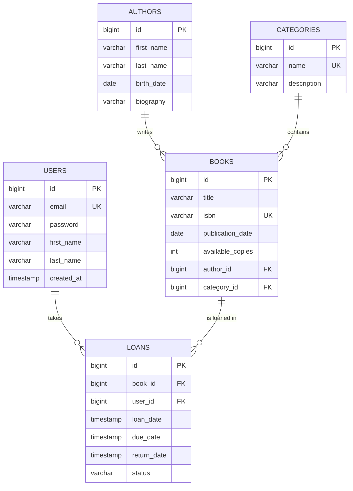

# Library Management

Учебный проект: серверная часть системы управления библиотекой на Spring Boot.
Практическая работа №1: создание проекта и базовых классов.

## Стек

- Java 21
- Spring Boot 4.1.2 (Spring Web, Spring Data JPA, Validation, DevTools)
- PostgreSQL 16
- Hibernate (JPA)
- Maven
- Lombok

## Возможности на текущем этапе

- Доменная модель: книги, авторы, категории, пользователи, выдачи книг
- Автоматическое создание таблиц в БД на основе сущностей
- Репозитории на Spring Data JPA
- Слой сервисов для книг и пользователей (интерфейсы и реализации)
- Демонстрационный компонент, который при запуске создаёт тестовые данные


## Структура проекта

```
src/main/java/com/pavel/library_management/
├── LibraryManagementApplication.java   # точка входа
├── controller/                         # REST-контроллеры (в разработке)
├── service/                            # бизнес-логика
│   ├── BookService.java
│   ├── BookServiceImpl.java
│   ├── UserService.java
│   └── UserServiceImpl.java
├── repository/                         # доступ к данным (Spring Data JPA)
├── entity/                             # JPA-сущности
├── dto/                                # объекты передачи данных (в разработке)
└── config/                             # конфигурация, DemoDataRunner
```

## Доменная модель

| Сущность | Таблица | Описание |
|---|---|---|
| `Category` | `categories` | Категория книг |
| `Author` | `authors` | Автор |
| `Book` | `books` | Книга (ISBN уникальный) |
| `User` | `users` | Пользователь библиотеки (email уникальный) |
| `Loan` | `loans` | Выдача книги пользователю |
| `LoanStatus` | поле `loans.status` | Статус выдачи: `ACTIVE`, `RETURNED`, `OVERDUE` |

Связи:

- Автор → Книги: один ко многим
- Категория → Книги: один ко многим
- Пользователь → Выдачи: один ко многим
- Книга → Выдачи: один ко многим

Каскадное удаление не используется, чтобы при удалении автора или категории не пропадали книги.

### ER-диаграмма



## Запуск

### Требования

- JDK 21
- PostgreSQL 14 или новее
- Git

### 1. Клонировать репозиторий

```bash
git clone https://github.com/pavel812bigtech/library-management.git
cd library-management
```

### 2. Создать базу данных

```bash
sudo -u postgres psql
```

```sql
CREATE USER library WITH PASSWORD 'library';
CREATE DATABASE library_db OWNER library;
\q
```

### 3. Проверить настройки подключения

Файл `src/main/resources/application.properties`:

```properties
spring.datasource.url=jdbc:postgresql://localhost:5432/library_db
spring.datasource.username=library
spring.datasource.password=library
```


### 4. Запустить приложение

```bash
./mvnw spring-boot:run
```

Либо из IntelliJ IDEA запустить класс `LibraryManagementApplication`.

После старта в консоли должны появиться строки:

```
Found 5 JPA repository interfaces
Started LibraryManagementApplication in ... seconds
```

При первом запуске Hibernate создаст таблицы, а `Test` добавит тестового автора и книгу и выведет результаты поиска в консоль.

Приложение доступно на порту 8080. Пока контроллеров нет, браузер вернёт страницу 404, это ожидаемо.

## Полезные команды

```bash
./mvnw clean package      # сборка проекта
./mvnw test               # запуск тестов
./mvnw clean              # удалить папку target
```


## Автор

Павел, `4354`, СПбГЭТУ «ЛЭТИ»